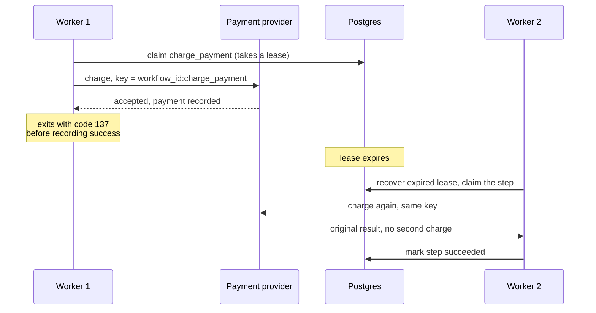
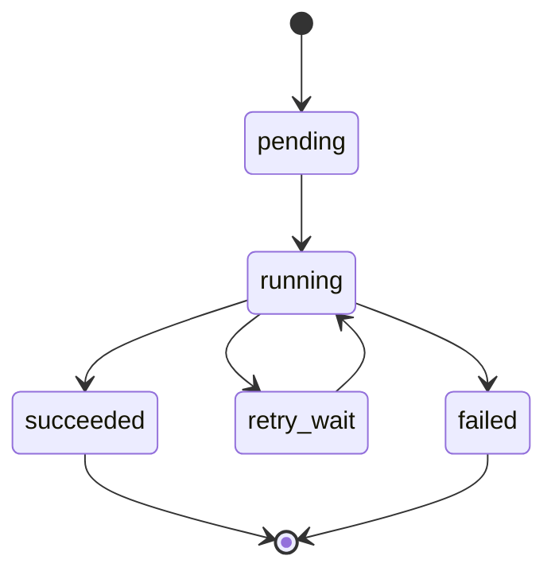

<div align="center">

# FlowForge

**A small workflow engine in Python and Postgres.**<br>
Built to answer one question: what happens when a worker charges a card and then crashes before it can write down that it did?


[The problem](#the-problem) · [Running it](#running-it) · [What works](#what-works-today) · [Limits](#what-it-doesnt-do) · [How it works](#how-it-works) · [What's next](#whats-next)

</div>

---

## The problem

Most workflows are more than one database write. You reserve some inventory, charge a card, send an email. If the worker dies between any two of those, the system needs to know what already happened, what's safe to try again, and what must never happen twice. (Charging someone twice is the obvious one.)

FlowForge runs a single workflow to poke at this. It's tiny on purpose:

```
reserve inventory  ->  charge payment  ->  send receipt
```

A step failing cleanly is the easy case. The one I care about is the ugly one:

1. The payment goes through.
2. The worker crashes before it records that.
3. The worker restarts with no idea the payment happened.

FlowForge keeps enough state in Postgres to get out of this. Once the dead worker's lease expires, another worker picks the payment step back up and retries it with the same idempotency key. The payment provider recognizes the key and returns the original result instead of charging again.



## Running it

You need Python 3.12 and Docker Desktop with Compose.

```bash
git clone https://github.com/neural-agi/flowforge.git
cd flowforge
cp .env.example .env

python3.12 -m venv .venv
source .venv/bin/activate
python -m pip install -e .

make up
make migrate
```

Then run the crash demo:

```bash
scripts/demo_crash_recovery.sh
```

The script starts a workflow, kills the worker for real right after the payment is accepted, starts a new worker after the lease expires, and checks that exactly one payment effect exists. The diagram above is the exact sequence it walks through.

<details>
<summary>Same thing, step by step</summary>

1. The worker charges the payment using the key `workflow_id:charge_payment`.
2. The mock provider records the payment.
3. The worker exits with code 137 before it can mark the step as succeeded.
4. The lease expires.
5. A new worker recovers the step and retries the payment.
6. The provider sees the same key and returns the original result.
7. The workflow finishes with one payment recorded.

</details>

## What works today

| Area | What's there |
| --- | --- |
| Workflow | One hardcoded workflow, `order_fulfillment`, that runs its steps in order |
| State | Workflow, step, attempt, lease, output, error, and history records, all stored in Postgres |
| Worker | A CLI worker that atomically claims the next runnable step and runs it |
| Retries | Bounded exponential backoff |
| Recovery | Expired worker leases get recovered, so abandoned steps can be tried again safely |
| Payments | A mock provider that stores one payment per idempotency key |
| Failure injection | Crash the worker on purpose after the payment is accepted but before the step is completed |
| CLI | Check a workflow's status and read its history in order |
| Tests | Unit tests, plus integration tests for the recovery logic that run against Postgres |

> [!NOTE]
> I wrote the integration tests but haven't run them against a live database yet (see the to-do list at the bottom).

## What it doesn't do

> [!WARNING]
> FlowForge gives you at-least-once execution. If a worker dies partway through a step, that step can run again.

There's no way for FlowForge to commit an external side effect (a charge, an email) and its own database write as one atomic operation, not without help from the external system. What makes a rerun safe is the idempotency key, and that only works if whatever you're calling honors one.

The payment provider here is a local mock, not a real gateway. I also left out parallel branches, worker pools, scheduling, auth, and a web UI so the failure case stays easy to follow.

## How it works

Each step moves through these states:



A worker claims a step by taking a lease that expires after a set time. If the worker dies, the lease just runs out, and the next worker treats the step as abandoned and picks it up. Steps that already succeeded never run again. Steps that were mid-flight when the worker died can, which is the whole reason the idempotency key matters.

Everything lives in five Postgres tables: `workflows`, `workflow_steps`, `step_attempts`, `workflow_events` (the history the CLI prints), and `payment_effects` (what the mock provider records).

The mock payment provider commits in its own transaction, separate from the one FlowForge uses later to mark the step complete. I did that on purpose. The gap between doing a side effect and writing down that you did it is exactly what I'm trying to model, and a real payment API would leave you with the same gap.

<details>
<summary>Repo layout</summary>

```
flowforge/
├── src/flowforge/
│   ├── worker.py          # claims and runs steps
│   ├── repository.py      # Postgres state transitions
│   ├── retry.py           # retry policy
│   ├── cli.py             # the CLI
│   ├── workflows/         # workflow definitions (in code)
│   └── activities/        # inventory, payment, receipt
├── migrations/            # Postgres schema
├── tests/                 # unit and integration tests
├── docs/                  # architecture and semantics notes
├── scripts/               # the crash-recovery demo
├── docker-compose.yml
└── Makefile
```

</details>

## Docs

- [docs/semantics.md](docs/semantics.md): execution guarantees, states, retries, leases, and what happens on failure
- [docs/architecture.md](docs/architecture.md): components, where state gets persisted, and the transaction design

## What's next

- [x] Sequential durable workflows
- [x] State and history in Postgres
- [x] Idempotent mock payment
- [x] Retries and lease recovery
- [x] Crash-after-side-effect demo
- [ ] Run the Postgres integration tests against a live database (needs a local Docker run)
- [ ] Multiple workers
- [ ] Parallel branches and joins
- [ ] HTTP API and a status UI
- [ ] Benchmarks with workers failing
