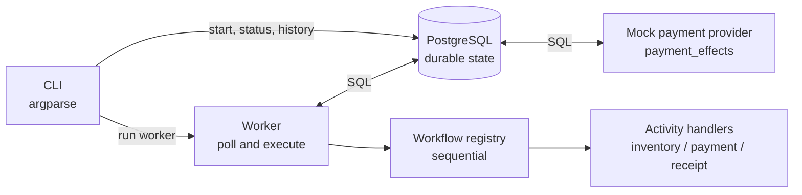
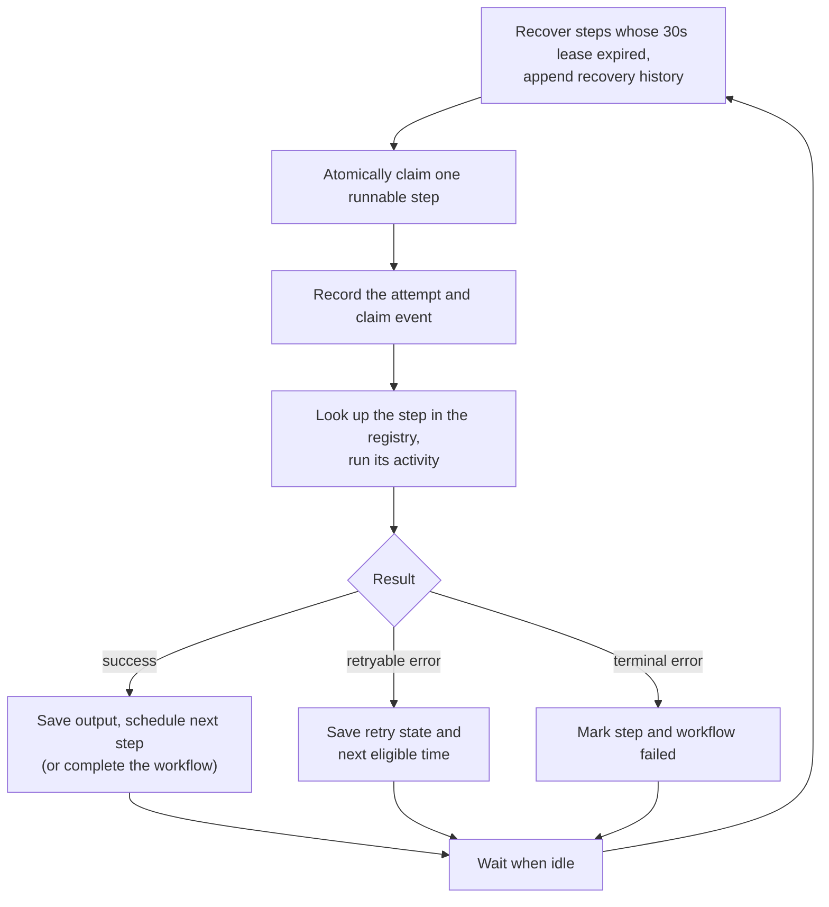

# FlowForge architecture

[← back to the README](../README.md)

FlowForge is a CLI-first execution engine written in Python 3.12 and backed by PostgreSQL. It runs one workflow that's defined in code. The stack is plain: `argparse` for the CLI, direct SQL through `psycopg`, and numbered SQL migrations for the schema.

[Big picture](#the-big-picture) · [Components](#components) · [Database](#database-entities) · [Worker loop](#the-worker-loop) · [Transactions](#transaction-boundaries) · [Multiple workers](#multiple-workers) · [Deferred](#deferred-work)

---

## The big picture

Those boxes are logical boundaries. They don't have to be separate services on a network. The mock payment provider is backed by Postgres so its uniqueness guarantee lives in the same local system, but it still stands in for a downstream service with real side effects.

## Components

| Component | What it does |
| --- | --- |
| **CLI** | Takes the start, worker, status, and history commands. It validates input and hands off to persistence or execution. It holds no state that correctness depends on. |
| **PostgreSQL** | The source of truth for workflows, steps, attempts, events, leases, retry timing, and payment effects. |
| **Worker** | Polls every second, recovers expired leases, claims eligible work, runs activities, and records the outcome. A worker can crash at any point. |
| **Workflow registry** | Maps the fixed workflow name and its step names to the ordered definition and the activity handler for each step. It's defined in code, so nobody authors workflows at runtime. |
| **Activity handlers** | Do the small domain operations for inventory, payment, and receipt. They return either success or a classified error, retryable or terminal. |
| **Mock payment provider** | Accepts a payment idempotency key, stores the first result, and returns that same result for duplicates. A unique constraint on the key is what stops two payments for one key. |

## Database entities

The schema lives in `migrations/`. These are the entities and the fields that matter most:

| Entity | Essential fields |
| --- | --- |
| `workflows` | workflow ID, workflow type, input, status, created/updated timestamps, completion/error data |
| `workflow_steps` | workflow ID, step name/order, state, input/output, attempt count, next eligible time, lease owner/expiry, error data, timestamps |
| `step_attempts` | attempt ID, workflow/step references, attempt number, worker identity, claimed/started/finished timestamps, outcome, error |
| `workflow_events` | event ID, workflow/step references, event type, attempt/worker metadata, payload, timestamp |
| `payment_effects` | idempotency key with a unique constraint, payment ID/result, request data, created timestamp |

## The worker loop

The same loop as a list

1. Recover running steps whose 30-second lease has expired and append recovery history.
2. Atomically claim one runnable step using row locks and `FOR UPDATE SKIP LOCKED` (or an equivalent safe pattern).
3. Record the attempt and the claim event as part of the claim transaction.
4. Resolve the step through the workflow registry and run its activity.
5. Persist success, retry, or terminal failure depending on the classified result.
6. On success, persist the output and schedule the next sequential step in one transaction. After the final step, mark the workflow completed.
7. In polling mode, poll again after one second only when no runnable work was processed; deterministic modes return when no work is due.

The worker can be stopped or killed between any two operations. Correctness comes from the state in Postgres, never from an in-memory queue or a local progress marker.

## Transaction boundaries

Three kinds of transaction do the real work, and each one commits everything it touches together:

| Transaction | What commits together |
| --- | --- |
| **Claim** | Locks an eligible step, assigns the worker and lease, records the attempt, writes the claim history. Competing workers skip locked rows, so two of them can't claim the same leased step. |
| **Completion** | Verifies the lease, stores the activity output, marks the step succeeded, writes the success event, and either makes the next step runnable or completes the workflow. |
| **Retry / failure** | Persists the outcome, the error, the event, and the next state. |

> [!WARNING]
> The external activity call sits outside the completion transaction on purpose. Postgres can't atomically commit together with an arbitrary external system, so an activity can succeed while FlowForge still has nothing recorded. Stable idempotency keys are what protect side effects that might get repeated.

## Multiple workers

The demo can run a single worker, but every claim is lease-based and coordinated through the database: worker identity, lease expiration, row locking, and `SKIP LOCKED`. There's no shared in-memory scheduler, so more workers can poll the same database later. Activities still have to honor their idempotency contract anywhere a side effect can repeat.

## Deferred work

Left out of the MVP on purpose:

- Parallel branches and joins
- Worker pools
- HTTP APIs
- Dashboards
- Benchmarks
