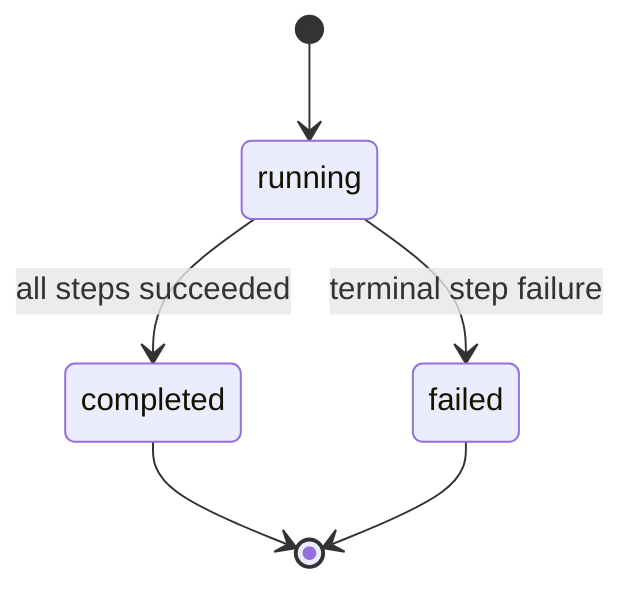
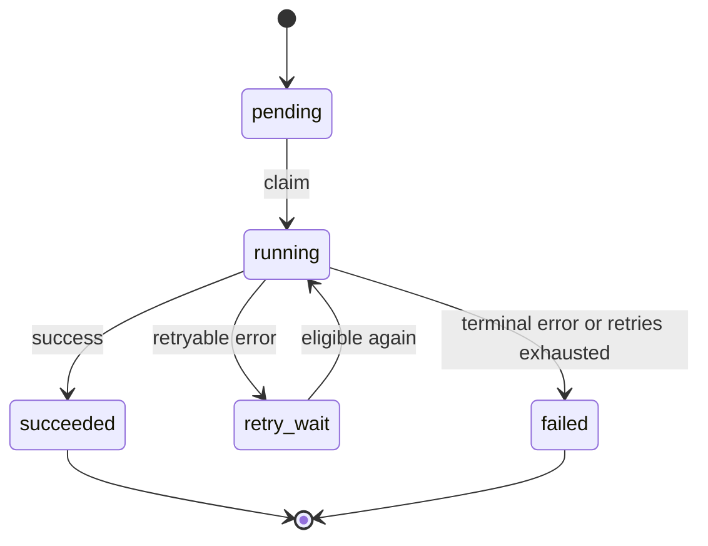
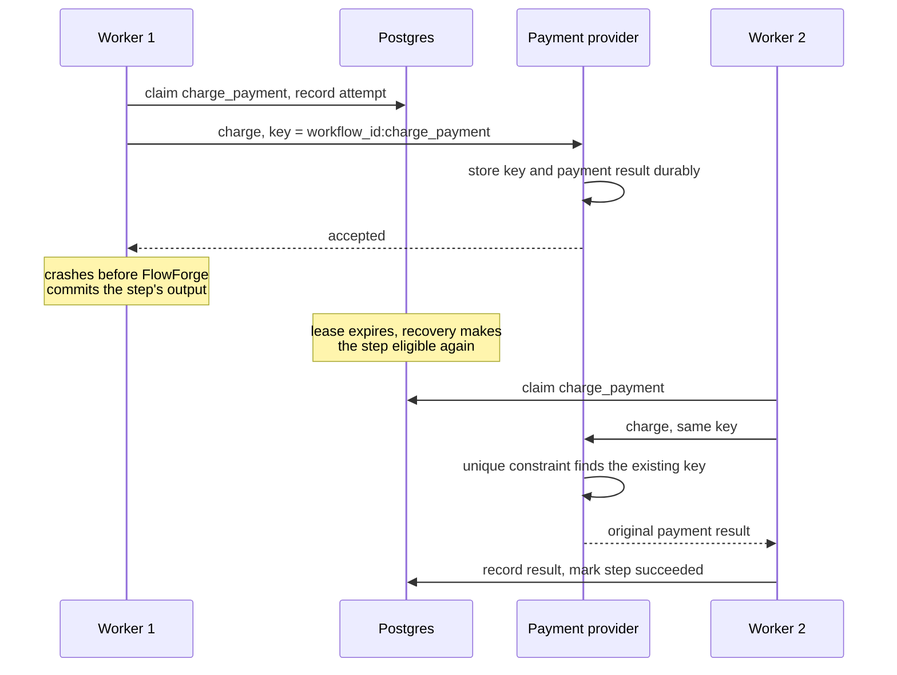

# FlowForge: how it behaves when things break

[← back to the README](../README.md)

This doc covers what FlowForge promises, what it doesn't, and what happens in the awkward window where a worker finishes a real-world action and dies before it can write that down.

[Goal](#goal) · [Guarantees](#guarantees-and-non-guarantees) · [State machines](#state-machines) · [Completion](#what-counts-as-complete) · [Happy path](#the-normal-path) · [Retries](#retries) · [Leases](#leases-and-recovery) · [The failure window](#the-failure-window) · [Failure injection](#failure-injection)

---

## Goal

FlowForge runs one small sequential workflow:

```
reserve_inventory  ->  charge_payment  ->  send_receipt
```

The case I built it around: a worker completes an external side effect, then crashes before FlowForge records that. When it comes back, FlowForge has to keep the workflow's progress and still avoid a duplicate side effect when it retries the interrupted step.

## Guarantees and non-guarantees

| What | Provided? | Notes |
| --- | --- | --- |
| Durable state in Postgres | **Yes** | Workflow and step state, attempts, timestamps, inputs, outputs, errors, and history |
| At-least-once step execution | **Yes** | A step can run again after an interruption or an expired lease |
| Persisted retries with backoff | **Yes** | Up to three total attempts; delays after attempts one and two are 1 and 2 seconds |
| Recovery after worker failure | **Yes** | Done through expiring worker leases |
| Deterministic side-effect keys | **Yes** | Format is `{workflow_id}:{step_name}`. An external system that honors the key can return the original result on a repeat request instead of creating another effect |
| Exactly-once execution or delivery | **No** | Not in general |
| A transaction spanning Postgres and an external system | **No** | |
| Automatic compensation or sagas | **No** | Not in the MVP |

> [!IMPORTANT]
> The idempotency boundary is explicit. FlowForge supplies a stable key, but the external system has to enforce that key's uniqueness and replay behavior. If it doesn't, a retry can duplicate the effect.

## State machines

A workflow is either running, completed, or failed:



A step has a few more states:



`retry_wait` is stored in the database. The worker doesn't sleep in memory and hope it remembers; the next eligible time is persisted.

## What counts as complete

> [!IMPORTANT]
> A step is complete only after FlowForge has committed its successful output and the matching success event in Postgres. An activity returning successfully doesn't count as completion on its own.

For a non-final step, that same transaction also makes the next step runnable.

## The normal path

1. The workflow and its ordered steps get inserted durably.
2. A worker atomically claims the first eligible step and records an attempt and a claim event.
3. The worker runs the activity, passing the deterministic idempotency key where it applies.
4. The worker commits the step output, the success state, the success event, and the scheduling of the next step in one transaction.
5. The worker repeats this for the next step.
6. Once `send_receipt` succeeds, the workflow is marked completed in that same completion transaction.

Completed steps can't be claimed again, so a normal restart never re-runs them.

## Retries

Only errors explicitly marked retryable (transient ones) move a step into `retry_wait`. The retry schedule is saved as the next eligible timestamp. The limit is three total attempts: a failure after attempt one waits 1 second before attempt two, and a failure after attempt two waits 2 seconds before attempt three. There is no 4-second wait because no fourth attempt is allowed.

- **Retryable error before the third attempt:** the worker records the error, the attempt result, a retry event, and the next eligible time. Once that time passes, any worker can claim the step.
- **Final allowed attempt fails:** the step becomes `failed` and the workflow fails for good.
- **Non-retryable error:** the step fails immediately.

## Leases and recovery

Claiming happens in a database transaction using row locks compatible with `FOR UPDATE SKIP LOCKED`. The claim records the worker's identity and a lease that expires 30 seconds later. A worker can only update its claimed step while it holds its current lease.

Every polling cycle starts by finding running work whose lease has expired, making it eligible again, and recording a recovery event. Recovery doesn't assume the original process is still alive. The database lease is the authority. The recovered step can then be claimed and run again, which is where the at-least-once behavior comes from.

## The failure window

There's always a gap between an activity's external effect and FlowForge's completion transaction. Here's what happens when a crash lands inside it:



No second payment gets created because the mock provider treats the idempotency key as the identity of the effect. Without that guarantee on the provider's side, the retry could duplicate the charge.

This is why interrupted steps may be re-executed and completed steps aren't. Completion is a durable FlowForge fact. A crash before that fact is committed leaves the step looking exactly like unfinished work, so the only safe move is to run it again and rely on the idempotency key. That closes the practical failure window without pretending to be exactly-once.

<details>
<summary>The same sequence as a list</summary>

1. FlowForge claims `charge_payment` and records its attempt.
2. The activity calls the payment provider with `{workflow_id}:charge_payment`.
3. The provider accepts the payment and durably stores the key and the result.
4. The worker crashes before FlowForge commits the step's successful output.
5. The lease expires, and recovery makes the step eligible again.
6. A worker retries `charge_payment` with the same deterministic key.
7. The provider's unique constraint finds the existing key and returns the original payment result.
8. FlowForge records that result and marks the step succeeded.

</details>

## Failure injection

To make the crash repeatable, set this environment variable:

```bash
FLOWFORGE_CRASH_AFTER_EFFECT=charge_payment
```

With that set, the worker terminates immediately after the payment provider accepts the side effect and before FlowForge records the step as complete. You end up with an expired lease and a provider-side idempotency record, which is exactly the state recovery has to deal with.
